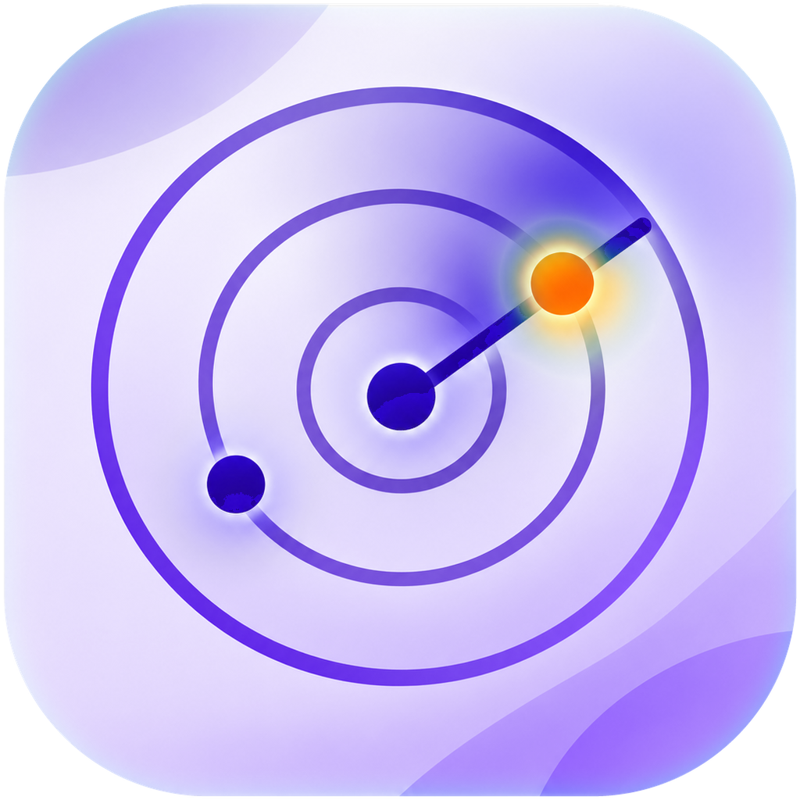
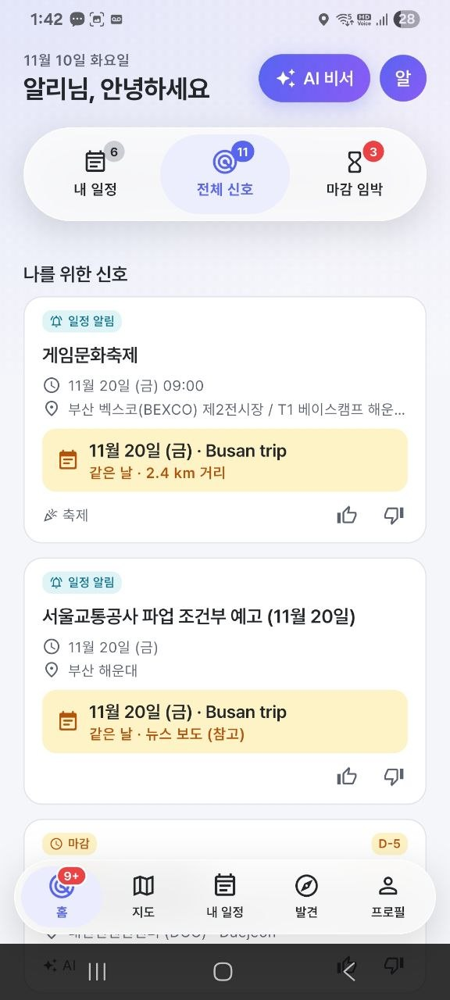
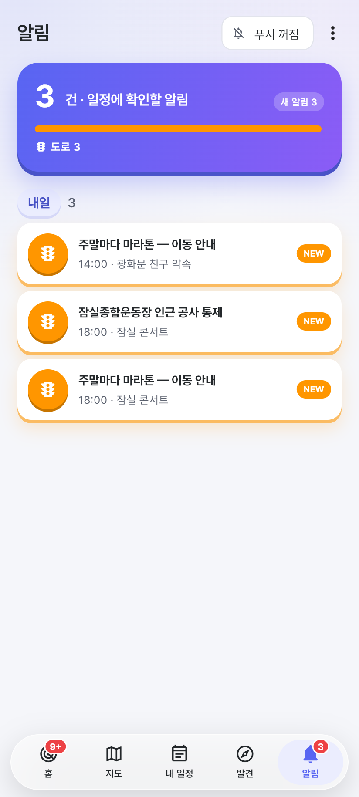
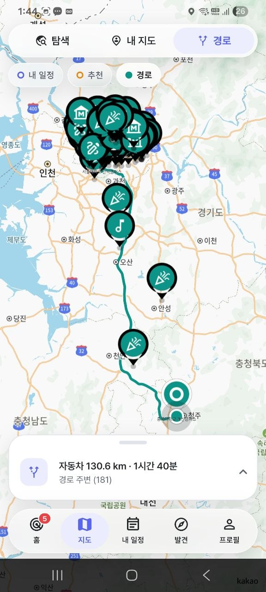
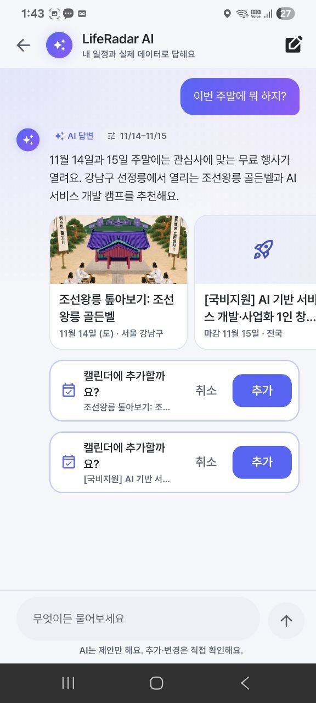
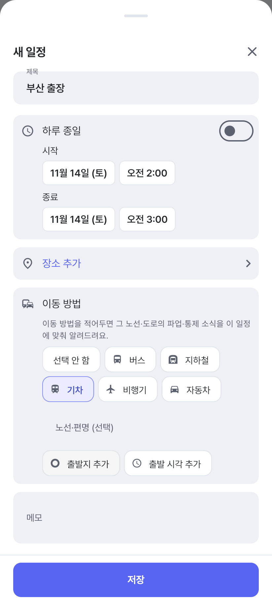
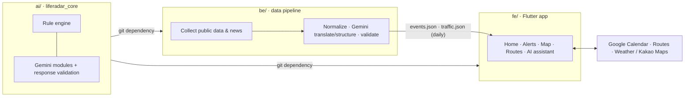

<div align="center">



[🇰🇷 한국어](README.md) · **🇬🇧 English** · [🇺🇿 O‘zbekcha](README.uz.md)

# LifeRadar

**An AI teammate that looks after your schedule**

LifeRadar connects your calendar, interests and travel routes with real events and traffic information — and tells you *"this matters to you, and here's why"* before you even ask.

[](https://youtu.be/Sjh8cfFDoKc)
[](https://drive.google.com/file/d/1n6Zk4ZCfaOjXBC2wYlcID8ptnPDMxG6i/view?usp=sharing)


2026 AI Woowangthon (Korea) · Team 27 **DaLab** · Theme: *"Can AI be a teammate?"*

</div>

<p align="center">
  
  
  
  
  
</p>

## ▶️ Watch · Install

<table>
<tr>
<td width="55%" align="center">
<a href="https://youtu.be/Sjh8cfFDoKc"></a>
<br><b>🎬 <a href="https://youtu.be/Sjh8cfFDoKc">Watch the demo (YouTube)</a></b>
</td>
<td width="45%" align="center">
<a href="https://drive.google.com/file/d/1n6Zk4ZCfaOjXBC2wYlcID8ptnPDMxG6i/view?usp=sharing"></a>
<br><b>📱 <a href="https://drive.google.com/file/d/1n6Zk4ZCfaOjXBC2wYlcID8ptnPDMxG6i/view?usp=sharing">Download the Android APK</a></b>
<br><sub>Scan the QR code with your phone camera</sub>
</td>
</tr>
</table>

**Install on Android** (Android 6.0+, version 1.0.11)
1. Download the APK from Google Drive using the link or QR code above.
2. Open the file. If you see *"Install unknown apps"*, go to **Settings → Allow from this source**.
3. Tap **Install**, open the app and choose **Continue with Google** or **Browse as guest**.

> If Google shows *"Google hasn't verified this app"* during sign-in, tap **Advanced → Go to LifeRadar** (it's a test app that hasn't gone through Google's app verification). If sign-in doesn't work, you can still try the main features as a guest. The app is available in Korean and English.

## The problem

Information about events and contests, strikes and road closures is scattered across many services. You have to search for it yourself and **compare it, one by one, with your own schedule and route** — so you hear about opportunities too late, or find out about a disruption on the day you travel.

## The solution — AI tells you, you decide

| | Feature | What it does |
|---|---|---|
| 🔔 | **Schedule alerts** | Links big events, strike news and official road closures near your plan's date and place to that plan — always with the **reason and the source** |
| 🗺️ | **Events along your route** | For your origin → destination and travel mode, finds events you care about near the route, with the extra distance and time |
| 🚆 | **Public transit routes** | Pick and save a real transit route between two plans (lines, stops, timetable); a strike or closure on that line becomes a warning for that plan |
| ✨ | **AI assistant** | Answers only from your schedule and real event data; adding to your calendar happens only when you tap **[Add]** |
| 🙋 | **AI interest setup** | Suggests interests from a sentence or two about yourself, **quoting your own words**; you confirm before anything is saved |
| 📅 | **Calendar & feedback** | Google Calendar sync, application-deadline reminders, 👍/👎 to re-rank recommendations |

## Keeping the AI from making things up

```
Public API facts ──▶ Rule engine (code) ──▶ Gemini (wording only) ──▶ Validation (code) ──▶ Card
date·place·link       decides what to show     explains why in words      unknown event or unsupported
                      (deterministic, tested)                              number → fall back to rule text
```

- **Code decides**: a rule engine scores by interest, taste, distance and time (`InsightEngine`, `RouteMatcher`, `TrafficMatcher`, `Taste`)
- **Gemini writes**: explanations, structuring strike news articles, interest suggestions, assistant replies
- **Code checks again**: a quote is shown only if it really appears in the source article, and a number only if it exists in the input facts

## Architecture



| Folder | Contents | Original repository |
|---|---|---|
| [`fe/`](fe/) | Flutter app (Android & web), Riverpod · go_router | [WOOWANGTHON_TEAM_27_FE](https://github.com/woowangthon/WOOWANGTHON_TEAM_27_FE) |
| [`be/`](be/) | Data pipeline that collects and publishes daily via GitHub Actions | [WOOWANGTHON_TEAM_27_BE](https://github.com/woowangthon/WOOWANGTHON_TEAM_27_BE) |
| [`ai/`](ai/) | Decision engine and AI modules (`liferadar_core`, pure Dart) | [WOOWANGTHON_TEAM_27_AI](https://github.com/woowangthon/WOOWANGTHON_TEAM_27_AI) |

The three folders keep the full commit history of the original repositories (`git subtree`, as submitted on 11/15). Each folder's README (in Korean) has the detailed design and setup.

## Data

- **658 events** — Seoul Open Data culture events · KOPIS performances · Korea Tourism Organization TourAPI festivals
- **Traffic** — Seoul TOPIS (city roads), ITS (highways & national roads), strike news reports (structured by Gemini, for reference)
- **Contests** — weekly collection from public portals

## Run it yourself

```bash
cd fe
flutter pub get
flutter run -d chrome --web-port=8080 --dart-define-from-file=env.json   # web
flutter build apk --release --split-per-abi --dart-define-from-file=env.json   # Android
```

`env.json` (API keys) is not included in the repository. See [fe/README.md](fe/README.md#8-실행) for the list of keys.

## Quality

**325 unit tests** (FE 145 · AI 105 · BE 75, as of 11/15), GitHub Actions CI on all three repositories.

## Team — DaLab

| Name | Role | Contribution |
|---|---|---|
| **Aliboev Abbos** | Frontend · Backend · AI | Flutter app screens, rule-based recommendation & traffic engines, Gemini integration (assistant, strike-news structuring), data collection pipeline |
| **Jeon Yeongwoo (전영우)** | Planning · Design · Development | Service planning, presentation & UI design, public data / external API research, traffic v2 & contest collection, transit route registration |

Development period: 2026-10-24 – 2026-11-15 · We used an AI coding assistant (Claude) during development and credited it as a co-author in commits.

## License

[MIT](LICENSE) © 2026 Abbos Aliboev, 전영우 (Team 27 DaLab)
