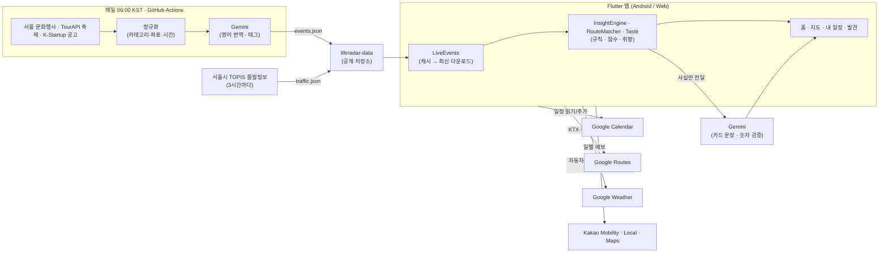

# LifeRadar AI

**내 일정과 관심사를 세상의 변화와 연결해, 놓치기 쉬운 기회를 먼저 찾아주는 개인 신호 레이더**

> Personal Signal Intelligence & Context-aware Map Discovery

<p align="center">
  
  
  
  
</p>

📖 **문서** · [사용자 가이드](docs/USER_GUIDE.md) · [개발자 가이드](docs/DEVELOPER.md) · MVP 계획 [한국어](docs/PLAN.ko.md) / [O'zbekcha](docs/PLAN.uz.md)

---

## 1. 한 줄 소개

LifeRadar는 사용자의 **Google 캘린더 일정**과 **관심사**를 **실제 행사·날씨·이동 경로**와 연결해서,
"이 정보가 **왜 나에게 중요한지**"를 설명하고 **지도 위에서** 보여주는 앱입니다. 사용자가 검색하기 전에 먼저 알려줍니다.

예를 들어 11월 20일에 부산 출장이 있다면, LifeRadar는

- 같은 날 숙소 근처 벡스코에서 **대형 축제**가 열려 교통·숙소가 붐빌 것을 **미리 경고**하고,
- 서울 → 부산 KTX 경로 근처인 **대전에서 같은 날 열리는 AI 세미나**를 찾아 **"+7.1 km, +17분"**이라고 알려주며,
- 관심 있는 창업 지원 공고의 **신청 마감이 이틀 남았을 때** 알림을 보냅니다.

## 2. 해결하려는 문제

| 문제 | 지금의 현실 |
|---|---|
| **정보는 많은데 나와 연결되지 않는다** | 일정은 캘린더에, 행사는 여러 플랫폼에, 날씨와 교통은 또 다른 앱에 있다. 서로의 영향은 사용자가 직접 판단해야 한다 |
| **기회를 놓친다** | 행사·해커톤·창업 지원 공고는 직접 찾아보지 않으면 마감이 지나고 나서야 알게 된다 |
| **검색해야만 답을 준다** | 검색 엔진, AI 챗봇, 지도 앱 모두 사용자가 먼저 질문해야 한다. 무엇을 물어야 할지 모르면 아무것도 얻지 못한다 |
| **이동 경로는 고려되지 않는다** | "가는 길에 들를 만한 행사가 있는가?"를 한 번에 보여주는 서비스가 없다 |
| **AI 답변을 믿기 어렵다** | 생성형 AI는 없는 행사나 틀린 날짜를 그럴듯하게 만들어낼 수 있다 |

**타깃 사용자:** 일정과 이동이 많고, 행사·해커톤·창업 지원처럼 놓치면 아쉬운 기회가 많은 **한국의 대학생·취업 준비생·주니어 개발자**. 지금은 학교 공지, 행사 플랫폼, 커뮤니티를 따로따로 확인하고 있습니다.

## 3. 해결 방법 — 세 가지 맥락을 연결

```
  개인 맥락                           외부 신호                            공간 맥락
  ─ Google 캘린더 일정                 ─ 실제 행사·축제·공연·전시            ─ 방문 예정 장소
  ─ 관심사 (AI, 스타트업, 음악…)        ─ 창업 지원 공고와 신청 마감          ─ 출발지 → 목적지 경로
  ─ 👍/👎 피드백으로 배운 취향           ─ 날씨 예보                          ─ 경로에서 벗어나는 거리·시간
                     \                         |                         /
                      └────────────  Connect the Dots  ─────────────────┘
                                             │
              "왜 중요한가" 설명 (Gemini) + 신뢰도·출처 + 지도 표시 + 캘린더 추가 + 알림
```

## 4. 기능과 존재 이유

| 기능 | 무엇을 하나 | 왜 필요한가 |
|---|---|---|
| **홈 — 인사이트 카드** | 일정 × 행사 × 날씨 × 관심사를 연결해 카드 자동 생성: 혼잡 경고, 체류 중 기회, 비 예보, 신청 마감 D-day, 새 기회 | 사용자가 묻지 않아도 "오늘 알아야 할 것"을 먼저 보여주기 위해 |
| **AI가 쓴 "왜 나에게 중요한가"** | 규칙 엔진이 고른 사실을 Gemini가 한국어·영어 문장으로 설명 (✨ AI 표시) | "관심사와 일치합니다" 같은 기계적인 문장 대신, 내 일정과 연결된 구체적인 이유를 주기 위해 |
| **피드백으로 배우는 취향** | 👍/👎/숨기기가 행사의 태그·카테고리 가중치를 바꿔 홈·발견·지도·경로 추천 순서를 다시 계산 | "이런 건 그만"이라고 한 번 말하면 비슷한 추천이 실제로 줄어들어야 하므로 |
| **지도 (Kakao Map)** | 내 일정 / 추천 행사 / 경로 기회를 레이어로 표시, 내 위치 | 행사가 "어디서" 열리는지는 목록보다 지도에서 더 빨리 판단할 수 있으므로 |
| **경로 기반 발견** | 출발지·목적지·날짜 → KTX(대중교통) 또는 자동차 경로를 그리고, 경로 15 km 이내 같은 날 행사를 **추가 거리·시간**과 함께 추천 | 이동은 이미 정해진 시간이다. 그 시간 안에서 "조금만 돌아가면 되는 기회"를 찾기 위해 |
| **Google 캘린더 연동** | 향후 90일 일정을 읽고, 행사를 내 캘린더에 추가, 일정 수정·삭제. Android에서는 링크가 Google 캘린더 앱으로 열림 | 사용자의 실제 계획이 있어야 "나와 관련된" 신호를 만들 수 있으므로 |
| **발견 (Discover)** | 관심사·취향 순으로 실제 행사 목록, 카테고리 필터, 무료 표시, 포스터·출처, 데이터 갱신 시각 | 홈 카드에 없는 기회도 직접 둘러볼 수 있게 |
| **알림** | 마감 2일 이내, 3일 이내 일정의 혼잡·비 예보를 시스템 알림으로 (신호당 1번). Android·웹 지원 | 마감처럼 시간이 중요한 신호는 앱을 열 때까지 기다리면 늦기 때문에 |
| **날씨 (Google Weather)** | 일정·행사 날짜와 장소의 일별 예보, 비 예보 강조 | 야외 행사와 이동 계획은 날씨에 따라 바뀌므로 |
| **첫 실행 설정 · 프로필** | 언어 → 테마 → 로그인(Google/게스트) → 이름 → 관심사 26개. 계정 삭제까지 | 처음 1분 안에 개인화된 결과를 보여주기 위해 |
| **한국어 / English · 라이트/다크** | 모든 화면 2개 언어, 행사명도 영어로 번역 (Gemini) | 한국에 사는 외국인 유학생·직장인도 쓸 수 있게 |
| **친절한 오류 메시지** | 인터넷 없음, 서비스 혼잡, 경로 없음 등을 사람이 읽을 수 있는 문장으로 | 기술적인 오류 대신 "무엇을 하면 되는지"를 알려주기 위해 |

<p align="center">
  
  
  
  
  
</p>

## 5. 데이터는 어디서, 언제 오나요?

### 실제 행사 데이터 — 매일 아침 자동 갱신

| 출처 | 내용 | 규모 (11/8 기준) |
|---|---|---|
| **서울 열린데이터광장** · 서울시 문화행사 | 공연·전시·축제·교육 | 331건 |
| **한국관광공사 TourAPI 4.0** · 축제·행사 | 전국 축제 | 100건 |
| **창업진흥원 K-Startup** · 사업공고 | 접수 중인 창업 지원 공고와 마감일 | 204건 |

모두 **공공누리** 라이선스의 공개 데이터이며, 향후 90일 범위를 다룹니다.

```
매일 06:00 (KST)  GitHub Actions
   ├─ 3개 공공 API에서 수집 → 카테고리·좌표·시간 정규화
   ├─ Gemini: 새 행사만 영어 번역 + 관심사 태그 (이전 번역은 캐시 → 하루 수십 건만 호출)
   ├─ 검증: 20건 미만이면 게시하지 않음
   └─ 공개 저장소 liferadar-data 에 events.json 게시

앱 실행 시
   ├─ 즉시: 앱에 포함된 데이터 또는 마지막으로 받은 데이터로 화면 표시 (오프라인 OK)
   └─ 백그라운드: 최신 events.json 다운로드 → 검증 (더 새롭고, 정상 형식일 때만) → 교체·저장
```

발견 화면 상단에 **"실제 공공데이터 · 행사 N개 · 업데이트 시각"**이 표시되어 데이터가 언제 기준인지 항상 알 수 있습니다.

### 공식 교통 영향 정보 — 3시간마다 갱신

| 출처 | 내용 |
|---|---|
| **서울시 TOPIS** · 실시간 돌발정보 (서울 열린데이터광장 `AccInfo`) | 집회·행사·훈련, 공사, 기상으로 인한 **도로 통제** — 시작·종료 시각, 위치, 원문 안내 |

GitHub Actions가 3시간마다 수집해 `liferadar-data/traffic.json`으로 게시하고, 앱은 내 일정과 비교합니다 (아래 6-1 참고). 교통사고처럼 짧은 돌발 상황은 갱신 주기에 맞지 않아 제외합니다.

### 실시간 API — 필요할 때 앱이 직접 호출

| 데이터 | API | 언제 |
|---|---|---|
| 내 일정 | Google Calendar | 캘린더 연결 시, 새로고침 시 |
| 날씨 예보 | Google Weather | 10일 이내 일정·행사를 볼 때 (장소별 캐시) |
| KTX·대중교통 경로 | Google Routes | 경로 탐색 시 |
| 자동차 경로, 장소 검색 | Kakao Mobility · Kakao Local | 경로 탐색·장소 입력 시 |
| 지도 | Kakao Maps SDK | 지도 화면 |
| 카드 설명 문장 | Gemini | 홈 카드가 바뀔 때, 상위 6개만 (결과는 기기에 캐시) |

### 샘플 데이터 — 데모 시나리오용

IT·AI 컨퍼런스나 해커톤은 공개 API가 없어 **샘플**(부산 AI 엑스포, 대전 AI 세미나 등)을 사용하며, 앱에서 `샘플 데이터` 배지로 구분됩니다. 장소 좌표는 실제(벡스코, COEX, KAIST)입니다. 데모 날짜가 지나도 시나리오가 깨지지 않도록 샘플 날짜는 자동으로 앞으로 이동합니다.

### 사용자 데이터 — 기기에만

관심사, 직접 만든 일정, 피드백, 설정은 **기기에만** 저장되며 서버로 보내지 않습니다.

## 6. 신뢰성 설계 — AI가 지어내지 않게

1. **사실은 공공 API에서만.** 행사의 날짜, 장소, 요금, 링크는 원본 그대로입니다.
2. **판단은 코드가 한다.** 날짜 겹침, 거리(km), 관심사 태그 일치, 예보, 피드백 가중치로 후보를 고르고 점수를 계산합니다 (`InsightEngine`, `RouteMatcher`, `Taste` — 단위 테스트 포함).
3. **AI는 언어만 다룬다.**
   - 수집 단계: 행사명·설명의 영어 번역과 허용된 26개 태그 중 선택. 한글이 섞인 번역은 거부하고 다시 요청합니다.
   - 홈 카드: 엔진이 고른 사실을 자연스러운 문장으로 설명합니다. **입력 사실에 없는 숫자(날짜·가격·거리)가 하나라도 있으면 그 문장은 버리고** 규칙 기반 문장을 그대로 보여줍니다.
4. **행사가 열린다는 사실만으로 교통 영향을 단정하지 않는다.** 일정 근처에 대형 행사가 있으면 "공식 교통 영향 정보는 아직 확인되지 않음"이라는 **참고 카드**만 보여주고 알림은 보내지 않습니다. 교통 영향 카드는 공식 통제 정보가 있을 때만 만듭니다.
5. **투명하게 표시한다.** 모든 카드에 신뢰도와 출처, AI가 쓴 문장에는 ✨ AI 표시, 번역된 행사명에는 "Gemini로 번역됨", 샘플에는 배지.

### 6-1. 교통 영향 판별 규칙

팀에서 작성한 「집회·마라톤·축제 뉴스의 이동 영향 판별 로직」의 핵심 규칙을 공식 통제 정보에 적용했습니다 (`TrafficMatcher`, 규칙 버전 1.0).

| 판별 | 규칙 |
|---|---|
| 시간 | 반열린 구간 `[시작, 종료)`로 비교 — 경계 시각이 같으면 겹치지 않음. 이동 기록이 없으면 **일정 시작 전 2시간**을 후보 구간으로 사용 (출발 권장 시간이 아님). 종일 일정은 날짜만 비교. 종료 시각 미상이면 시작 날짜에만 적용하고 무기한 활성화하지 않음 |
| 공간 | 공식 통제 위치에서 일정 장소까지 **1 km 이내**면 인근 (탐지 설정이며 혼잡 확산 거리가 아님). 일정 장소가 없으면 판별 보류 |
| 이동수단 | 일정에는 이동수단이 저장되지 않으므로 **미확인** → 결과는 최대 `CAUTION` |
| 결과 | `CAUTION` 카드만 생성. 문구는 템플릿: "이용하실 교통수단과 접근 경로에 영향이 있는지 확인해 주세요". 지연·통행 불가를 단정하지 않고, Gemini가 다시 쓰지 않음 |
| 제외 | 이미 시작한 일정, 시간 또는 공간 불일치 → `IGNORE` |

아직 구현하지 않은 부분: 뉴스 기사 추출(집회·파업 기사, 철회·취소 판별), 경로(자동차) 단위 `ROUTE_MATCH`와 `RECOMMEND`, 전국 단위 통제 정보(ITS 국가교통정보센터).

## 7. 차별화 — 기존 서비스와 무엇이 다른가

| | 캘린더 앱<br/>(Google·네이버) | 지도 앱<br/>(카카오맵·네이버지도) | 행사·대외활동 플랫폼 | AI 챗봇<br/>(Gemini·ChatGPT 등) | **LifeRadar** |
|---|---|---|---|---|---|
| 묻기 전에 먼저 알려줌 | △ 일정 알림만 | ✕ | △ 구독 알림 | ✕ | **◎** |
| 내 일정 × 외부 행사·날씨 연결 | ✕ | ✕ | ✕ | ○ 물어보면 | **◎ 자동** |
| 이동 경로 주변 기회 + 우회 비용(+km/+분) | ✕ | △ 경로 주변 장소 검색 | ✕ | ✕ | **◎** |
| 신청 마감 추적 | ✕ | ✕ | ○ | ✕ | **◎** |
| "왜 나에게 중요한지" + 출처·신뢰도 | ✕ | ✕ | ✕ | ○ (출처 불확실) | **◎** |
| 사실 오류 방지 장치 | — | — | — | △ | **◎ 숫자 검증** |
| 피드백으로 추천 조정 | — | △ | △ | △ | **◎** |

◎ 핵심 기능 · ○ 지원 · △ 일부 · ✕ 없음 — *팀의 초기 비교이며, 각 서비스의 기능은 계속 바뀔 수 있습니다.*

**핵심 차별점:** 다른 서비스는 각각 *시간(캘린더)*, *공간(지도)*, *정보(행사·AI)* 중 하나를 잘합니다. LifeRadar는 **내 계획(시간) × 이동 경로(공간) × 외부 신호(정보)**를 한 번에 교차시켜, 사용자가 존재조차 몰랐던 기회를 찾아냅니다. 그리고 그 근거를 숫자와 출처로 보여줍니다.

## 8. 데모 시나리오 (약 3분)

1. **첫 실행** — 언어 → 테마 → **게스트로 둘러보기**(또는 Google 로그인) → 이름 → 관심사 *AI, 스타트업, 음악·공연*.
2. **홈** — 첫 카드: *Busan trip — 같은 날 가까운 벡스코에서 게임문화축제, 혼잡 예상* (**실제 TourAPI 데이터**). 카드를 열면 ✨ AI가 쓴 이유, 신뢰도, 출처.
3. **마감 임박** — **K-Startup 실제 창업 공고**의 D-day → **신청하기**로 공식 페이지, **캘린더에 추가**.
4. **지도 → 경로** — 서울역 → 부산역, 11월 20일, 대중교통 → **대전 AI 세미나 +7.1 km · +17분**. 자동차로 바꾸면 고속도로가 대전에서 멀어 추천되지 않음 → *이동 수단까지 고려하는 추천*.
5. **피드백** — 콘서트 카드에 👎 → 비슷한 콘서트의 점수가 내려간다. 두 번 누르면 콘서트 대신 다른 관심사(AI) 행사가 추천된다.
6. **알림** — 세미나 신청 마감 2일 전, 시스템 알림 *"신청 마감이 다가와요"*.

자세한 준비 체크리스트: [docs/DEMO.uz.md](docs/DEMO.uz.md)

## 9. 개인정보 보호

- 사용자가 **직접 연결 버튼을 눌러야만** 캘린더에 접근합니다 (Google OAuth 동의 화면). 권한은 `calendar.events` 하나.
- 액세스 토큰은 **기기 메모리에만** 보관하며, 일정은 서버에 저장하지 않습니다. `연결 해제`로 언제든 끊을 수 있습니다.
- 홈 카드 문장을 만들 때 해당 카드의 일정 제목·장소가 Gemini API로 전송됩니다.
- 위치는 지도의 "내 위치"와 일정 장소의 좌표 변환에만 사용합니다.
- **계정 삭제** 시 기기의 모든 데이터를 지우고 Google 접근 권한을 해제합니다.

## 10. 기술 스택

| 영역 | 사용 기술 |
|---|---|
| 앱 | **Flutter 3.41** (Android + Web), Riverpod 3, go_router, `gen_l10n` (ko/en), shared_preferences |
| AI | **Gemini** (gemini-3.5-flash-lite, 실패 시 3.1-flash-lite) — 구조화 JSON 출력, 숫자 근거 검증, 기기 캐시 |
| 행사 데이터 | 서울 열린데이터광장, 한국관광공사 TourAPI 4.0, 창업진흥원 K-Startup |
| 데이터 파이프라인 | `tool/collect_events.dart` + **GitHub Actions** (매일 06:00 KST) → 공개 저장소 `liferadar-data` |
| 지도 | **Kakao Maps SDK** (Android 네이티브 / Web JS) |
| 경로 | **Google Routes API** (대중교통·KTX), **Kakao Mobility** (자동차 — Google은 한국 자동차 길찾기 미지원) |
| 장소 검색·지오코딩 | **Kakao Local API** |
| 일정 · 로그인 | **Google Calendar API**, Google Sign-In (Android·웹) + 게스트 모드 |
| 날씨 | **Google Weather API** (일별 예보) |
| 알림 | Android: `flutter_local_notifications`, 웹: Notification API |
| 디자인 | 자체 디자인 시스템 (라이트/다크 토큰, 대비 4.5:1 이상, 모션 줄이기 지원), 글꼴 **LifeRadar Sans** (Pretendard 서브셋, OFL) |
| 테스트 | 단위·위젯 테스트 83개 (엔진, 경로, 취향, AI 검증, 데이터 갱신, 오류 분류, 화면 흐름) |

## 11. 아키텍처



## 12. 현재 상태와 한계 (2026-11-08 기준)

- ✅ 지도, 경로 기반 발견(실제 KTX/자동차 경로), Google 캘린더 읽기·추가·수정, 날씨 예보가 **실제 API로 동작**합니다.
- ✅ 실제 행사 데이터가 **매일 자동 갱신**되고, 앱은 실행할 때 최신 데이터를 받습니다.
- ✅ 홈 카드의 설명 문장을 **Gemini가 작성**하고, 숫자 검증을 통과한 문장만 보여줍니다.
- ✅ 👍/👎 피드백이 홈·발견·지도·경로의 추천 순서에 반영됩니다.
- 🟡 IT·AI 컨퍼런스와 해커톤은 공개 API가 없어 **샘플**입니다 (배지로 구분). KOPIS(공연) 데이터는 추가 예정입니다.
- 🟡 알림은 **앱이 실행 중일 때** 보냅니다. 앱이 완전히 닫혀 있어도 오는 서버 푸시(FCM)는 설계만 되어 있습니다 → [docs/PUSH_NOTIFICATIONS.uz.md](docs/PUSH_NOTIFICATIONS.uz.md)
- 🟡 지도·경로·날씨·Gemini API 키는 데모를 위해 **앱 안에** 있습니다. 다음 단계에서 서버 프록시로 옮길 계획입니다.
- 🟡 관심사·일정·피드백은 **이 기기에만** 저장됩니다. 기기 간 동기화는 서버 도입 후 가능합니다.
- 대중교통 경로의 "추가 시간"은 *가장 가까운 경로 지점(역)에서 행사장까지 왕복* 기준의 추정치입니다.

## 13. 로드맵

| 시점 | 내용 |
|---|---|
| ✅ ~11/8 | 실제 데이터 매일 갱신, Gemini 카드 문장 + 숫자 검증, 피드백 기반 취향 학습, Android 알림·Google 로그인, 친절한 오류 메시지 |
| ~11/12 | 휴대폰 실기기 테스트, 해커톤 저장소(front / back / ai)로 이전, 발표 자료 |
| ~11/13 | 데모 영상, (여유가 있으면) FCM 서버 푸시 |
| 11/14 | **해커톤 제출** |
| 이후 | API 키 서버 이전, KOPIS 공연, 채용·장학금 신호, 기기 간 동기화, 알림 빈도 개인화 |

## 14. 실행 방법

```bash
cd app
cp env.example.json env.json        # API 키 입력
dart run tool/gen_web_env.dart      # Kakao 지도 JS SDK 설정 생성
flutter run -d chrome --web-port=8080 --dart-define-from-file=env.json \
  --web-browser-flag="--user-data-dir=$PWD/.dart_tool/chrome-profile"   # 로그인·관심사·일정 유지

# Android APK
flutter build apk --release --split-per-abi --dart-define-from-file=env.json

# (선택) 행사 데이터를 직접 수집 — 보통은 GitHub Actions가 매일 실행
dart run tool/collect_events.dart
```

최신 행사 데이터 주소는 기본값으로 `liferadar-data` 저장소를 사용하며, `--dart-define=EVENTS_URL=...`로 바꾸거나 빈 값으로 끌 수 있습니다.
키 발급, 도메인 등록, 테스트 방법은 👉 [개발자 가이드](docs/DEVELOPER.md)를 참고하세요.

## 15. 팀

| 이름 | 역할 |
|---|---|
| Abbos Aliboev | 아키텍처 · 디자인 · 개발 |
| (팀원) | (추가 예정) |
