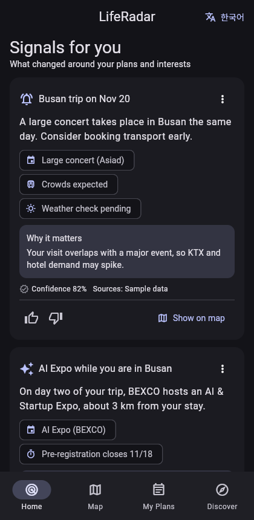
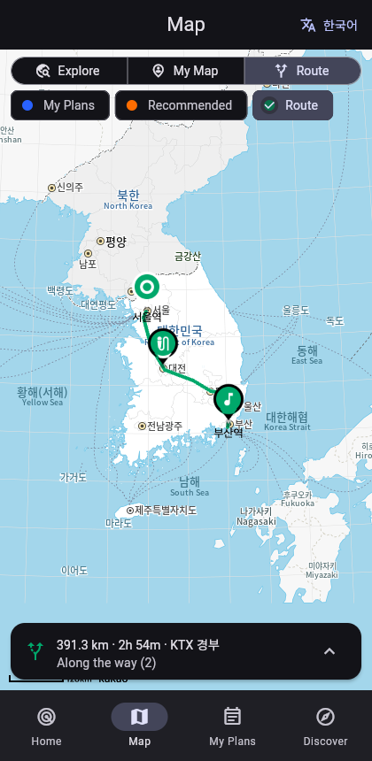
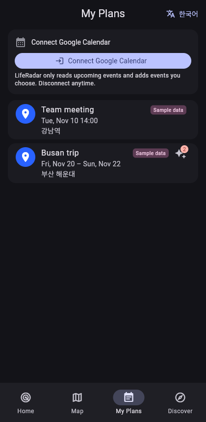
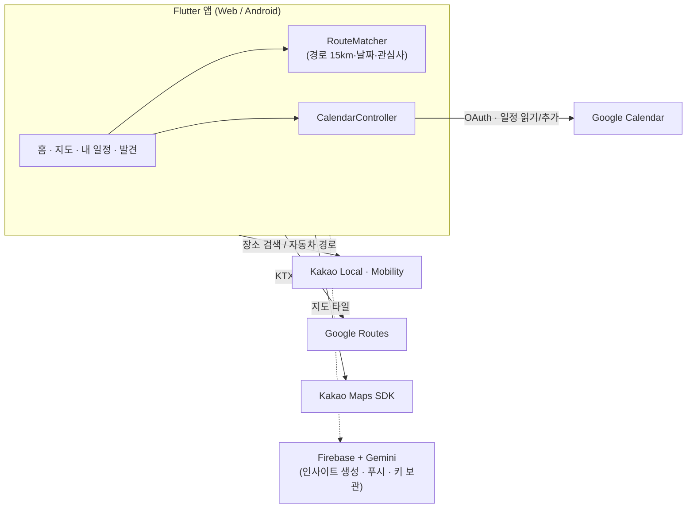

# LifeRadar AI

**내 일정과 관심사를 세상의 변화와 연결해, 놓치기 쉬운 기회를 먼저 찾아주는 개인 신호 레이더**

> Personal Signal Intelligence & Context-aware Map Discovery

<p align="center">
  
  
  
</p>

📖 **문서** · [사용자 가이드](docs/USER_GUIDE.md) · [개발자 가이드](docs/DEVELOPER.md) · MVP 계획 [한국어](docs/PLAN.ko.md) / [O'zbekcha](docs/PLAN.uz.md)

---

## 1. 한 줄 소개

LifeRadar는 사용자의 **Google 캘린더 일정**과 **관심사**를 **행사·날씨·이동 경로** 같은 외부 정보와 연결해서,
"이 정보가 **왜 나에게 중요한지**"를 설명하고 **지도 위에서** 보여주는 앱입니다.

예를 들어 서울에서 부산으로 KTX를 타고 가는 날이라면, LifeRadar는 경로 근처인 **대전에서 같은 날 열리는 AI 세미나**를 찾아
**"대전역에서 내리면 +7.1 km, +17분"** 이라고 알려줍니다.

## 2. 해결하려는 문제

| 문제 | 지금의 현실 |
|---|---|
| **정보 과부하** | 매일 쏟아지는 정보 중 나에게 중요한 것을 골라내기 어렵다 |
| **놓치는 기회** | 행사·해커톤·장학금은 직접 검색하지 않으면 모르고 지나간다 |
| **연결되지 않는 정보** | 일정, 행사, 날씨, 교통을 각각 따로 확인하고 영향은 스스로 판단해야 한다 |
| **수동적인 탐색** | 대부분의 서비스는 사용자가 먼저 검색하거나 질문해야 답을 준다 |
| **공간 정보의 한계** | 이동하는 길 주변에 내가 참여할 만한 행사가 있는지 한눈에 볼 수 없다 |

## 3. 타깃 사용자

**1차 타깃: 한국의 대학생·취업 준비생·주니어 개발자**

- 학교, 아르바이트, 지방 이동 등 일정이 많고 **이동이 잦다**
- AI·스타트업·개발 행사, 해커톤, 채용 설명회처럼 **놓치면 아쉬운 기회**가 많다
- 여러 사이트(행사 플랫폼, 학교 공지, 커뮤니티)를 **따로따로 확인**하고 있다

## 4. 해결 방법

LifeRadar의 핵심은 세 가지 맥락을 **연결**하는 것입니다.

```
  개인 맥락 (Personal Context)        외부 신호 (External Signals)        공간 맥락 (Spatial Context)
  ─ Google 캘린더 일정                 ─ 행사·컨퍼런스·공연                 ─ 방문 예정 장소
  ─ 관심사 (AI, 스타트업…)             ─ 날씨 예보                          ─ 출발지 → 목적지 경로
  ─ 목표                               ─ (예정) 채용·장학금                 ─ 경로에서 벗어나는 거리/시간
                     \                         |                         /
                      └────────────  Connect the Dots  ─────────────────┘
                                             │
                     "왜 중요한가" 설명 + 지도 표시 + 캘린더에 바로 추가
```

## 5. 핵심 기능

| 기능 | 설명 | 상태 |
|---|---|---|
| **지도 (Kakao Map)** | 내 일정 / 추천 이벤트 / 경로 기회를 레이어로 켜고 끄기 | ✅ 동작 |
| **경로 기반 발견 (Route)** | 출발지·목적지·날짜 입력 → **KTX(대중교통)** 또는 **자동차** 경로를 그리고, 경로 15 km 이내의 같은 날 행사를 찾아 **추가 거리·시간**과 함께 추천 | ✅ 동작 (실제 경로 API) |
| **Google 캘린더 연동** | 사용자 동의 후 향후 90일 일정을 읽어 **내 일정**과 지도에 표시 (장소는 자동으로 좌표 변환) | ✅ 동작 (웹) |
| **캘린더에 추가** | 마음에 드는 행사를 버튼 하나로 내 Google 캘린더에 등록 | ✅ 동작 (웹) |
| **발견 (Discover)** | 관심사와 얼마나 맞는지 순서로 행사 목록, 카테고리 필터 | ✅ 동작 |
| **홈 — AI 인사이트** | 일정 + 행사 + 날씨를 연결한 카드, "중요한 이유", 신뢰도, 출처, 👍/👎 피드백 | 🟡 UI 완성, 현재 샘플 데이터 |
| **한국어 / English** | 모든 화면 2개 언어 지원 | ✅ 동작 |
| AI 설명 생성 (Gemini) | 연결된 정보를 바탕으로 "왜 중요한지"를 자연어로 설명 | 🔜 다음 단계 |
| 실제 행사 데이터 | 한국관광공사 TourAPI(축제), KOPIS(공연) 연동 | 🔜 다음 단계 |
| 선제적 푸시 알림 | 새 인사이트가 생기면 먼저 알림 | 🔜 계획 |

<p align="center">
  
  
  
</p>

## 6. 데모 시나리오 (약 3분)

1. **홈** — "11월 20일 부산 방문 예정이시군요. 같은 날 부산에서 대형 콘서트가 열립니다. 교통편을 미리 예약하세요." 카드와 *중요한 이유*, 신뢰도를 보여준다.
2. **내 일정** — `Google 캘린더 연결`을 눌러 실제 캘린더 일정을 불러온다. 장소가 있는 일정은 지도에 파란 핀으로 나타난다.
3. **지도 → 경로** — `데모: 서울역 → 부산역`, 날짜 11월 20일, **대중교통** 선택 → `경로 주변 기회 찾기`
   - KTX 경부선 경로(391 km, 2시간 54분)가 지도에 그려진다
   - **대전 AI 세미나**가 1순위로 추천된다: **+7.1 km · +17분**
4. 세미나를 눌러 상세 정보를 보고 → **캘린더에 추가** → 내 Google 캘린더에 바로 등록된다.
5. 같은 경로를 **자동차**로 바꾸면 고속도로가 대전을 지나지 않아(약 68 km 떨어짐) 세미나가 추천되지 않는다 → **이동 수단까지 고려하는 추천**임을 보여준다.

## 7. 차별화 — 기존 서비스와 무엇이 다른가

| | Google Gemini | Perplexity | Google Maps / 카카오맵 | 행사 플랫폼 | **LifeRadar** |
|---|---|---|---|---|---|
| 묻기 전에 먼저 알려줌 | △ | ✕ | ✕ | △ (구독 알림) | **◎** |
| 내 일정과 외부 정보 연결 | ○ | ✕ | ✕ | ✕ | **◎** |
| 이동 경로 주변 기회 발견 | ✕ | ✕ | △ (장소 검색) | ✕ | **◎** |
| 경로 이탈 비용(+km/+분) 계산 | ✕ | ✕ | ✕ | ✕ | **◎** |
| "왜 나에게 중요한지" 설명 + 출처 | ○ | ◎ | ✕ | ✕ | **◎** |

◎ 핵심 기능 · ○ 지원 · △ 일부 · ✕ 없음 — *팀의 초기 비교이며, 각 서비스의 기능은 계속 바뀔 수 있습니다.*

**핵심 차별점:** 단순한 검색·지도·알림이 아니라, *내 계획(시간)* × *이동 경로(공간)* × *외부 신호*를 **한 번에 교차**시켜 기회를 찾는다.

## 8. 신뢰성 설계 — AI가 지어내지 않게

LifeRadar는 **AI가 행사를 만들어내지 않도록** 두 단계로 설계했습니다.

1. **결정적 매칭 (코드)** — 날짜 겹침, 경로와의 거리(km), 관심사 태그 일치로 후보를 고르고 점수를 계산한다.
   *(이미 구현: `RouteMatcher` — 단위 테스트 포함)*
2. **AI 설명 (Gemini, 다음 단계)** — AI는 1단계에서 고른 후보만 받아 "왜 중요한지"를 설명한다. 출처는 항상 실제 URL.

모든 추천 카드에는 **신뢰도**와 **출처**가 함께 표시되고, 샘플 데이터에는 `샘플 데이터` 배지가 붙습니다.

## 9. 개인정보 보호

- 사용자가 **직접 연결 버튼을 눌러야만** 캘린더에 접근한다 (Google OAuth 동의 화면).
- 권한은 `calendar.events` 하나 — 일정 **읽기**와 사용자가 고른 행사 **추가**만 한다.
- 액세스 토큰은 **기기 메모리에만** 보관하고 서버에 저장하지 않는다. `연결 해제`로 언제든 끊을 수 있다.
- 일정 장소의 좌표 변환에만 위치 정보를 사용한다.

## 10. 기술 스택

| 영역 | 사용 기술 |
|---|---|
| 앱 | **Flutter 3.41** (Web + Android), Riverpod 3, go_router, `gen_l10n` (ko/en) |
| 지도 | **Kakao Maps SDK** (`kakao_map_sdk` — Android 네이티브 / Web JS SDK) |
| 경로 | **Google Routes API** (대중교통·KTX), **Kakao Mobility** (자동차 — Google은 한국 자동차 길찾기 미지원) |
| 장소 검색·지오코딩 | **Kakao Local API** |
| 일정 | **Google Calendar API** + Google Identity Services (OAuth) |
| 날씨 (연동 예정) | Google Weather API |
| AI (예정) | Gemini |
| 백엔드 (예정) | Firebase (Auth, Firestore, Cloud Functions, FCM) |

## 11. 아키텍처



현재 MVP는 앱에서 외부 API를 직접 호출합니다. 다음 단계에서 API 호출과 키를 **Cloud Functions로 옮겨** 키를 앱 밖으로 숨기고, 매일 자동으로 인사이트를 만들어 푸시합니다.

## 12. 현재 상태와 한계 (2026-11-06 기준)

솔직하게 정리한 현재 상태입니다.

- ✅ 지도, 경로 기반 발견(실제 KTX/자동차 경로), Google 캘린더 읽기/추가가 **실제 API로 동작**합니다.
- 🟡 **행사 데이터와 홈 인사이트는 샘플**입니다 (장소 좌표는 실제 — BEXCO, COEX, 대전컨벤션센터 등). 앱에서 `샘플 데이터` 배지로 구분됩니다.
- 🟡 Google 로그인은 현재 **웹에서만** 설정되어 있습니다 (Android OAuth 클라이언트는 다음 단계).
- 🟡 API 키가 아직 앱(클라이언트) 쪽에 있습니다 → Cloud Functions로 이전 예정.
- 대중교통 경로의 "추가 시간"은 *가장 가까운 경로 지점(역)에서 행사장까지 왕복* 기준의 추정치입니다.

## 13. 로드맵

| 시점 | 내용 |
|---|---|
| ~11/10 | 실제 행사 데이터(TourAPI·KOPIS), Google Weather 연동 |
| ~11/12 | Gemini 인사이트 생성(캘린더 일정 × 행사 × 날씨), 피드백 반영 |
| ~11/13 | Firebase로 키 이전, 푸시 알림, Android 데모 빌드 |
| 11/14 | **해커톤 제출** |
| 이후 | 채용·장학금 신호, 산업 동향, 알림 빈도 개인화 |

## 14. 실행 방법

```bash
cd app
cp env.example.json env.json        # API 키 입력
dart run tool/gen_web_env.dart      # Kakao 지도 JS SDK 설정 생성
flutter run -d chrome --web-port=8080 --dart-define-from-file=env.json
```

키 발급, 도메인 등록, 테스트 방법은 👉 [개발자 가이드](docs/DEVELOPER.md)를 참고하세요.

## 15. 팀

| 이름 | 역할 |
|---|---|
| Abbos Aliboev | 아키텍처 · 디자인 · 개발 |
| (팀원) | (추가 예정) |
