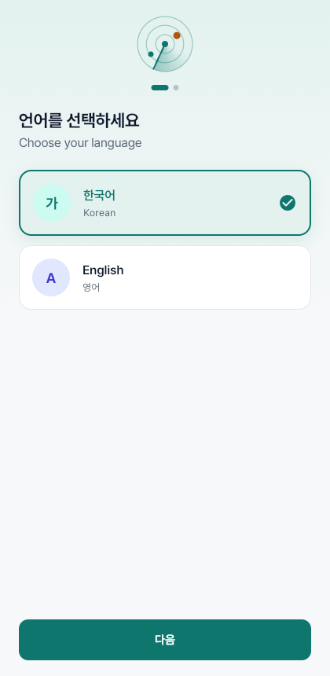
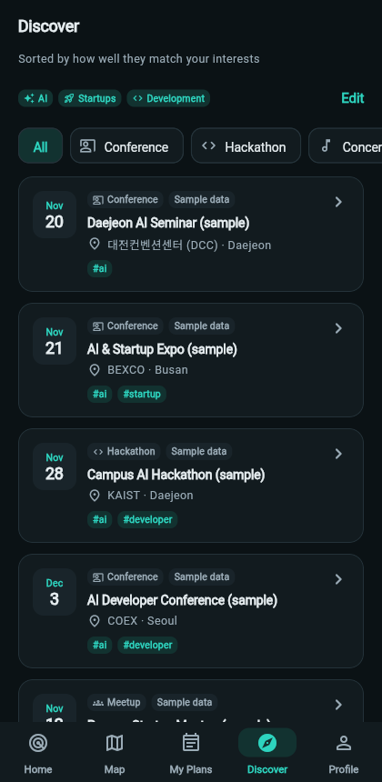
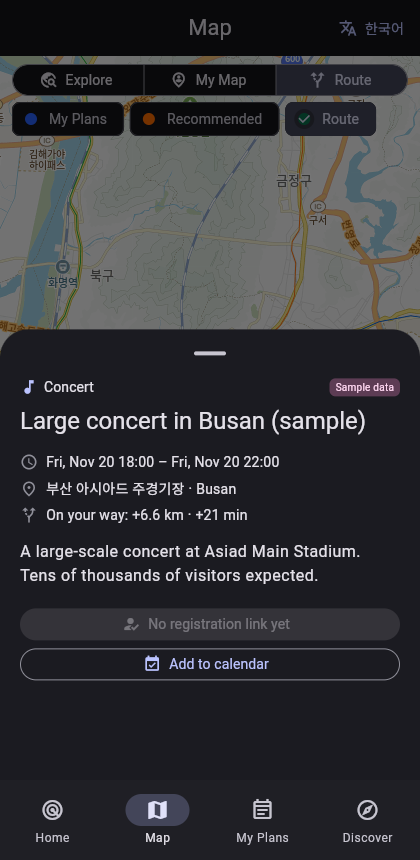
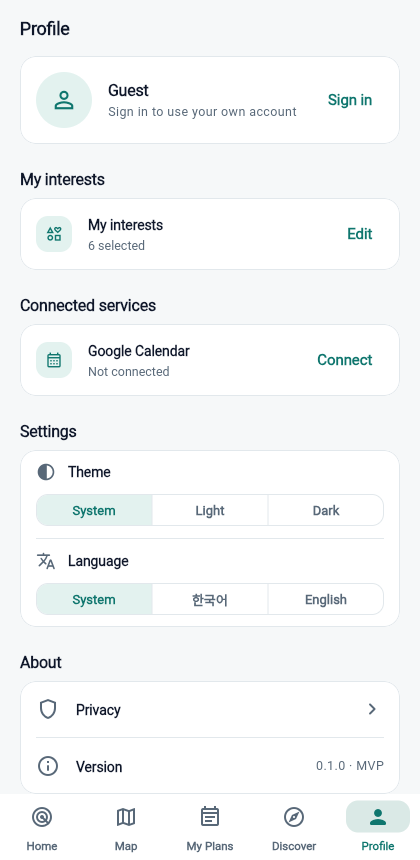
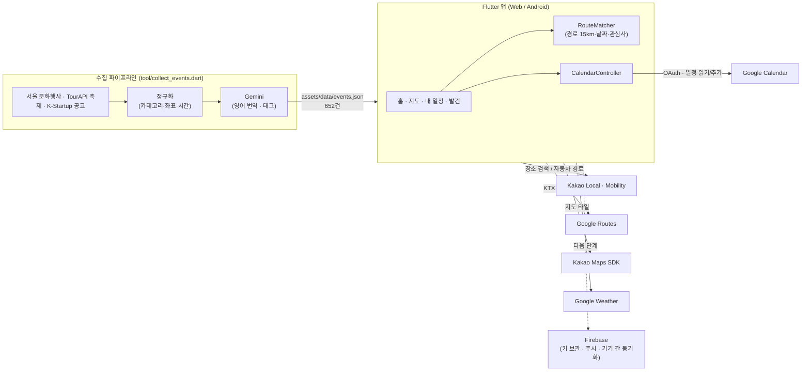

# LifeRadar AI

**내 일정과 관심사를 세상의 변화와 연결해, 놓치기 쉬운 기회를 먼저 찾아주는 개인 신호 레이더**

> Personal Signal Intelligence & Context-aware Map Discovery

<p align="center">
  
  
  
  
</p>

📖 **문서** · [사용자 가이드](docs/USER_GUIDE.md) · [개발자 가이드](docs/DEVELOPER.md) · MVP 계획 [한국어](docs/PLAN.ko.md) / [O'zbekcha](docs/PLAN.uz.md)

---

## 1. 한 줄 소개

LifeRadar는 사용자의 **Google 캘린더 일정**과 **관심사**를 **행사·날씨·이동 경로** 같은 외부 정보와 연결해서,
"이 정보가 **왜 나에게 중요한지**"를 설명하고 **지도 위에서** 보여주는 앱입니다.

예를 들어 서울에서 부산으로 KTX를 타고 가는 날이라면, LifeRadar는 경로 근처인 **대전에서 같은 날 열리는 AI 세미나**를 찾아
**"대전역에서 내리면 +7.1 km, +17분"** 이라고 알려줍니다.

## 2. 해결하려는 문제

| 문제 | 지금의 현실 |
|---|---|
| **정보 과부하** | 매일 쏟아지는 정보 중 나에게 중요한 것을 골라내기 어렵다 |
| **놓치는 기회** | 행사·해커톤·장학금은 직접 검색하지 않으면 모르고 지나간다 |
| **연결되지 않는 정보** | 일정, 행사, 날씨, 교통을 각각 따로 확인하고 영향은 스스로 판단해야 한다 |
| **수동적인 탐색** | 대부분의 서비스는 사용자가 먼저 검색하거나 질문해야 답을 준다 |
| **공간 정보의 한계** | 이동하는 길 주변에 내가 참여할 만한 행사가 있는지 한눈에 볼 수 없다 |

## 3. 타깃 사용자

**1차 타깃: 한국의 대학생·취업 준비생·주니어 개발자**

- 학교, 아르바이트, 지방 이동 등 일정이 많고 **이동이 잦다**
- AI·스타트업·개발 행사, 해커톤, 채용 설명회처럼 **놓치면 아쉬운 기회**가 많다
- 여러 사이트(행사 플랫폼, 학교 공지, 커뮤니티)를 **따로따로 확인**하고 있다

## 4. 해결 방법

LifeRadar의 핵심은 세 가지 맥락을 **연결**하는 것입니다.

```
  개인 맥락 (Personal Context)        외부 신호 (External Signals)        공간 맥락 (Spatial Context)
  ─ Google 캘린더 일정                 ─ 행사·컨퍼런스·공연                 ─ 방문 예정 장소
  ─ 관심사 (AI, 스타트업…)             ─ 날씨 예보                          ─ 출발지 → 목적지 경로
  ─ 내가 만든 일정                     ─ 창업 지원 공고·마감                 ─ 경로에서 벗어나는 거리/시간
                     \                         |                         /
                      └────────────  Connect the Dots  ─────────────────┘
                                             │
                     "왜 중요한가" 설명 + 지도 표시 + 캘린더에 바로 추가
```

## 5. 핵심 기능

| 기능 | 설명 | 상태 |
|---|---|---|
| **로그인 / 가입** | Google 계정으로 계속하기(= 가입) 또는 게스트로 둘러보기. 이름·이메일·사진만 프로필에 사용 | ✅ 동작 (웹) |
| **첫 실행 설정** | 언어 → 테마(미리보기, 즉시 적용) → 로그인 → 이름 → 관심사. 모두 저장되어 다시 묻지 않음 | ✅ 동작 |
| **프로필 · 설정** | 관심사, 연결된 서비스(캘린더), 테마(시스템/라이트/다크), 언어(시스템/한국어/English), 개인정보 안내, 로그아웃 | ✅ 동작 |
| **온보딩 — 관심사 선택** | 5개 그룹·26개 관심사(기술, 커리어, 문화·예술, 운동·야외, 맛집·가족·반려동물 등)를 색으로 구분해 선택. 발견 순서·경로 추천·추천 이유에 바로 반영. **계정별 저장**이라 다시 로그인해도 유지 | ✅ 동작 |
| **지도 (Kakao Map)** | 내 일정 / 추천 이벤트 / 경로 기회를 레이어로 켜고 끄기 | ✅ 동작 |
| **경로 기반 발견 (Route)** | 출발지·목적지·날짜 입력 → **KTX(대중교통)** 또는 **자동차** 경로를 그리고, 경로 15 km 이내의 같은 날 행사를 찾아 **추가 거리·시간**과 함께 추천 | ✅ 동작 (실제 경로 API) |
| **Google 캘린더 연동** | 사용자 동의 후 향후 90일 일정을 읽어 **내 일정**과 지도에 표시 (장소는 자동으로 좌표 변환) | ✅ 동작 (웹) |
| **일정 추가·수정·삭제** | 앱에서 직접 일정 만들기(종일/시간, 장소 검색, 메모). 캘린더 일정은 수정하면 Google 캘린더에도 반영 | ✅ 동작 (캘린더 쓰기는 웹) |
| **캘린더에 추가** | 마음에 드는 행사를 버튼 하나로 내 Google 캘린더에 등록 | ✅ 동작 (웹) |
| **발견 (Discover)** | 관심사와 얼마나 맞는지 순서로 행사 목록, 카테고리 필터, 무료 표시, 포스터·출처 | ✅ 동작 |
| **실제 행사 데이터 수집** | `tool/collect_events.dart`가 공공 API에서 향후 90일 행사를 모아 정규화(카테고리·관심사 태그·좌표) → 앱에 포함. 키는 앱에 들어가지 않음 | ✅ 서울 + 전국 축제 + 창업 공고 |
| **Gemini 번역·태깅** | 수집 단계에서 Gemini가 한국어 행사명·설명을 자연스러운 영어로 옮기고 관심사 태그를 붙임 (사실 정보는 변경하지 않음, 품질 검사 + 캐시). 영어 화면에 "Gemini로 번역됨" 표시 | ✅ 동작 (652건 중 651건) |
| **홈 — 인사이트 엔진** | 일정 × 행사 × 날씨 × 관심사를 규칙으로 연결해 카드 자동 생성: 혼잡 경고, 체류 중 기회, 비 예보, 신청 마감 D-day, 새 기회 | ✅ 동작 |
| **홈 — 한눈에 읽히는 카드** | 카드에는 *무엇·언제·어디서·누구에게(관심사)*만, 긴 제목은 옆으로 흐름. 탭하면 포스터·"이 신호가 뜬 이유"·신뢰도·출처·신청/캘린더. 상단 숫자 3개 = 필터(내 일정 / 전체 / 마감 임박), 본 카드는 흐리게, 👎는 확인 후 반영 | ✅ 동작 |
| **날씨 (Google Weather)** | 일정·행사 날짜와 장소의 예보(최고/최저, 강수 확률) 표시, 비 예보 강조 | ✅ 동작 (약 10일 범위) |
| **한국어 / English · 라이트/다크** | 모든 화면 2개 언어, 두 테마 모두 대비 4.5:1 이상의 디자인 시스템 | ✅ 동작 |
| AI 설명 생성 (Gemini) | 엔진이 만든 카드의 문장을 자연스럽게 다듬기 (사실은 엔진이 결정) — 키를 숨길 서버 필요 | 🔜 다음 단계 |
| 공연 데이터 (KOPIS) | 전국 공연·콘서트 | 🔜 키 발급 대기 |
| 선제적 푸시 알림 | 새 인사이트가 생기면 먼저 알림 | 🔜 계획 |

<p align="center">
  
  
  
  
  
</p>

## 6. 데모 시나리오 (약 3분)

0. **첫 실행** — 언어(한국어) → 테마(다크) 를 고르면 즉시 바뀐다 → **게스트로 둘러보기** → 이름 *Abbos* → 관심사 *AI, 스타트업, 음악·공연*.
1. **홈** — "Abbos님, 안녕하세요". 첫 카드는 **실제 TourAPI 데이터**: *Busan trip(11/20) — 같은 날 2.4 km 거리 벡스코에서 **게임문화축제**(11/19–22), 혼잡 예상*. 카드를 누르면 포스터와 "이 신호가 뜬 이유", 신뢰도, 출처가 열린다.
2. **마감 임박** 숫자를 누르면 **K-Startup 실제 창업 공고**만 남는다 (예: D-2) → **신청하기**로 바로 지원 페이지 이동, **캘린더에 추가**하면 마감일 아침 알림으로 등록.
3. **발견** — 서울시 공연·전시·축제 347건이 관심사 순으로. 영어로 바꾸면 행사명도 Gemini가 번역한 영어로 보인다 ("Translated from Korean with Gemini").
4. **지도 → 경로** — `데모: 서울역 → 부산역`, 11월 20일, **대중교통** → `경로 주변 기회 찾기`
   - KTX 경부선 경로(391 km, 2시간 54분)가 지도에 그려진다
   - **대전 AI 세미나(샘플)**가 1순위: **+7.1 km · +17분**
   - **자동차**로 바꾸면 고속도로가 대전에서 약 68 km 떨어져 추천되지 않는다 → *이동 수단까지 고려하는 추천*.
5. **내 일정** — **＋ 새 일정**으로 일정을 만들거나 `Google 캘린더 연결`로 실제 일정을 불러오면 홈 카드가 바로 다시 계산된다.

## 7. 차별화 — 기존 서비스와 무엇이 다른가

| | Google Gemini | Perplexity | Google Maps / 카카오맵 | 행사 플랫폼 | **LifeRadar** |
|---|---|---|---|---|---|
| 묻기 전에 먼저 알려줌 | △ | ✕ | ✕ | △ (구독 알림) | **◎** |
| 내 일정과 외부 정보 연결 | ○ | ✕ | ✕ | ✕ | **◎** |
| 이동 경로 주변 기회 발견 | ✕ | ✕ | △ (장소 검색) | ✕ | **◎** |
| 경로 이탈 비용(+km/+분) 계산 | ✕ | ✕ | ✕ | ✕ | **◎** |
| "왜 나에게 중요한지" 설명 + 출처 | ○ | ◎ | ✕ | ✕ | **◎** |

◎ 핵심 기능 · ○ 지원 · △ 일부 · ✕ 없음 — *팀의 초기 비교이며, 각 서비스의 기능은 계속 바뀔 수 있습니다.*

**핵심 차별점:** 단순한 검색·지도·알림이 아니라, *내 계획(시간)* × *이동 경로(공간)* × *외부 신호*를 **한 번에 교차**시켜 기회를 찾는다.

## 8. 신뢰성 설계 — AI가 지어내지 않게

LifeRadar는 **AI가 행사를 만들어내지 않도록** 두 단계로 설계했습니다.

1. **사실은 공공 API에서만** — 행사·축제·공고의 날짜, 장소, 요금, 링크는 서울시·한국관광공사·창업진흥원 공개 데이터 원본 그대로입니다.
2. **결정적 매칭 (코드)** — 날짜 겹침, 거리(km), 관심사 태그 일치, 예보로 후보를 고르고 점수를 계산한다.
   *(`InsightEngine`(홈 카드), `RouteMatcher`(경로) — 단위 테스트 포함)*
3. **AI는 언어만 다룬다 (Gemini)** — 수집 단계에서 행사명·설명의 **영어 번역**과 **관심사 태그 선택**(26개 허용 목록 안에서)만 한다. 사실을 바꾸지 않으며, 한글·일본어가 섞인 번역은 자동으로 거부하고 다시 요청한다. 영어 화면에는 "Gemini로 번역됨"을 표시한다.

모든 추천에는 **신뢰도**와 **출처**(공공누리 표시 포함)가 함께 있고, 샘플 데이터에는 `샘플 데이터` 배지가 붙습니다.

## 9. 개인정보 보호

- 사용자가 **직접 연결 버튼을 눌러야만** 캘린더에 접근한다 (Google OAuth 동의 화면).
- 권한은 `calendar.events` 하나 — 일정 **읽기**와 사용자가 고른 행사 **추가**만 한다.
- 액세스 토큰은 **기기 메모리에만** 보관하고 서버에 저장하지 않는다. `연결 해제`로 언제든 끊을 수 있다.
- 일정 장소의 좌표 변환에만 위치 정보를 사용한다.

## 10. 기술 스택

| 영역 | 사용 기술 |
|---|---|
| 앱 | **Flutter 3.41** (Web + Android), Riverpod 3, go_router, `gen_l10n` (ko/en), shared_preferences |
| 디자인 | 자체 디자인 시스템 (Teal + 뉴트럴, 관심사별 12색, 4/8dp 간격, 라이트/다크 토큰, 스켈레톤·토스트·통일된 스피너, 페이드/슬라이드 전환, 모션 줄이기 지원) |
| 글꼴 | **LifeRadar Sans** — Pretendard 서브셋(라틴 + 한글 2,350자, OFL) |
| 행사 데이터 | **서울 열린데이터광장**(문화행사), **한국관광공사 TourAPI 4.0**(축제), **창업진흥원 K-Startup**(사업공고) — `tool/collect_events.dart`로 수집 |
| 로그인 | Google Identity Services (웹 공식 버튼) + 게스트 모드 |
| 지도 | **Kakao Maps SDK** (`kakao_map_sdk` — Android 네이티브 / Web JS SDK) |
| 경로 | **Google Routes API** (대중교통·KTX), **Kakao Mobility** (자동차 — Google은 한국 자동차 길찾기 미지원) |
| 장소 검색·지오코딩 | **Kakao Local API** |
| 일정 | **Google Calendar API** + Google Identity Services (OAuth) |
| 날씨 | **Google Weather API** (일별 예보) |
| AI | **Gemini** (gemini-3.5-flash-lite, 실패 시 3.1-flash-lite) — 수집 단계 영어 번역·관심사 태깅, 구조화 JSON 출력 |
| 백엔드 (예정) | Firebase (Auth, Firestore, Cloud Functions, FCM) |

## 11. 아키텍처



행사 데이터용 키(서울·공공데이터포털·Gemini)는 **수집 스크립트에서만** 쓰이고 앱 번들에는 들어가지 않습니다. 지도·경로·날씨 키는 아직 앱에서 직접 호출하며, 다음 단계에서 Cloud Functions로 옮길 계획입니다.

## 12. 현재 상태와 한계 (2026-11-07 기준)

솔직하게 정리한 현재 상태입니다.

- ✅ 지도, 경로 기반 발견(실제 KTX/자동차 경로), Google 캘린더 읽기/추가, 날씨 예보가 **실제 API로 동작**합니다.
- ✅ 홈 카드는 **인사이트 엔진이 실제 일정·날씨로 자동 생성**합니다.
- 🟢 **실제 데이터 652건** (향후 90일): 서울시 문화행사 **347건** + 한국관광공사 TourAPI 전국 축제 **110건**(부산 12, 경기 16 등) + 창업진흥원 K-Startup 접수 중인 **창업 지원 공고 195건**(마감 D-day 알림). 출처는 상세 화면에 표시됩니다.
  데모의 *부산 출장 × 벡스코 게임문화축제(11/19–22)* 혼잡 경고는 실제 TourAPI 데이터에서 나옵니다.
- 🟡 **아직 샘플인 데이터**: IT·AI 컨퍼런스·해커톤(부산 AI 엑스포, 대전 AI 세미나 등)은 공개 API가 없어 샘플이며 `샘플 데이터` 배지로 구분됩니다. KOPIS(공연)는 키 발급 후 추가합니다.
- 🟡 Google 로그인은 현재 **웹에서만** 설정되어 있습니다 (Android OAuth 클라이언트는 다음 단계).
- 🟡 지도·경로·날씨 API 키는 아직 앱(클라이언트) 쪽에 있습니다 → Cloud Functions로 이전 예정. (행사 데이터·Gemini 키는 앱에 없음)
- 🟡 로그인·관심사·일정은 **이 기기에만** 저장됩니다 (계정별). 기기 간 동기화는 Firebase 도입 후.
- 서울 데이터에는 영어 제목이 없어 Gemini 번역을 씁니다 (652건 중 651건, 나머지 1건은 원래 영어).
- 대중교통 경로의 "추가 시간"은 *가장 가까운 경로 지점(역)에서 행사장까지 왕복* 기준의 추정치입니다.

## 13. 로드맵

| 시점 | 내용 |
|---|---|
| ✅ 11/7 | 실제 데이터 652건(서울·TourAPI·K-Startup), Gemini 번역·태깅, 첫 실행 설정·이름, 홈 카드 개편, 토스트·글꼴 |
| ~11/10 | KOPIS 공연 데이터, 웹 배포(심사용 링크) |
| ~11/12 | 피드백(👍/👎)을 추천 가중치에 반영, 인사이트 문장 다듬기 |
| ~11/13 | Firebase로 키 이전, 푸시 알림, Android 데모 빌드 |
| 11/14 | **해커톤 제출** |
| 이후 | 채용·장학금 신호, 산업 동향, 알림 빈도 개인화 |

## 14. 실행 방법

```bash
cd app
cp env.example.json env.json        # API 키 입력
dart run tool/gen_web_env.dart      # Kakao 지도 JS SDK 설정 생성
dart run tool/collect_events.dart   # (선택) 실제 행사 데이터 새로 수집 — 키 필요, 없으면 커밋된 데이터 사용
flutter run -d chrome --web-port=8080 --dart-define-from-file=env.json \
  --web-browser-flag="--user-data-dir=$PWD/.dart_tool/chrome-profile"   # 로그인·관심사·일정 유지
```

키 발급, 도메인 등록, 테스트 방법은 👉 [개발자 가이드](docs/DEVELOPER.md)를 참고하세요.

## 15. 팀

| 이름 | 역할 |
|---|---|
| Abbos Aliboev | 아키텍처 · 디자인 · 개발 |
| (팀원) | (추가 예정) |
