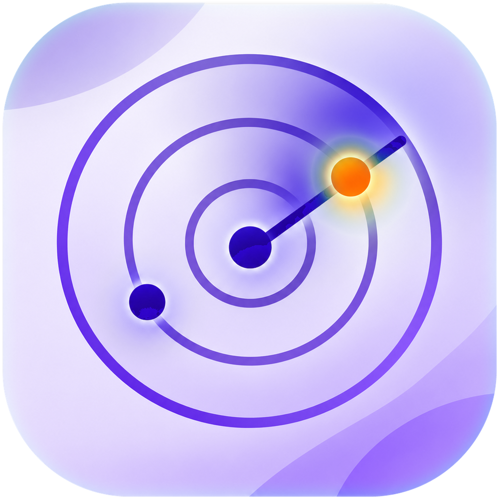
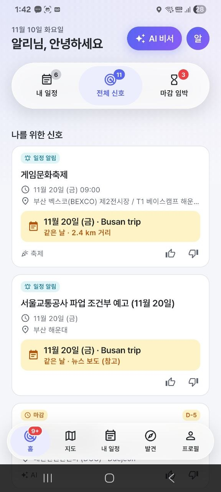
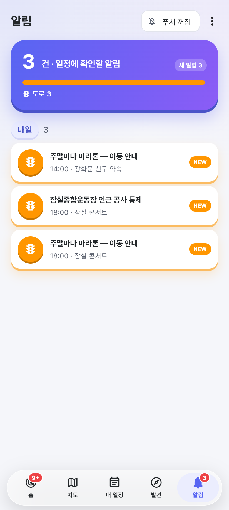
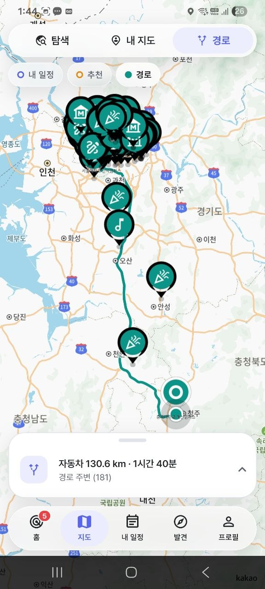
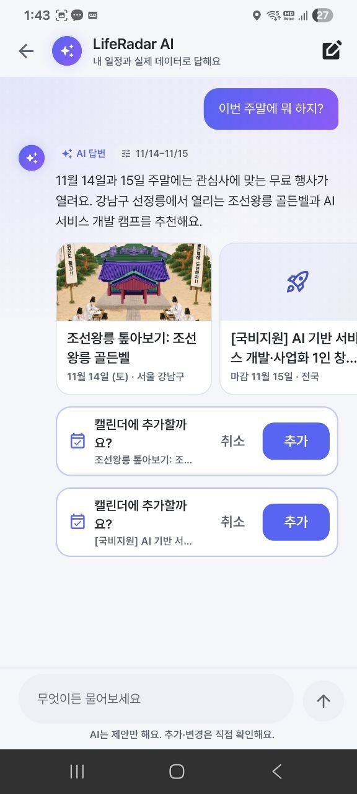
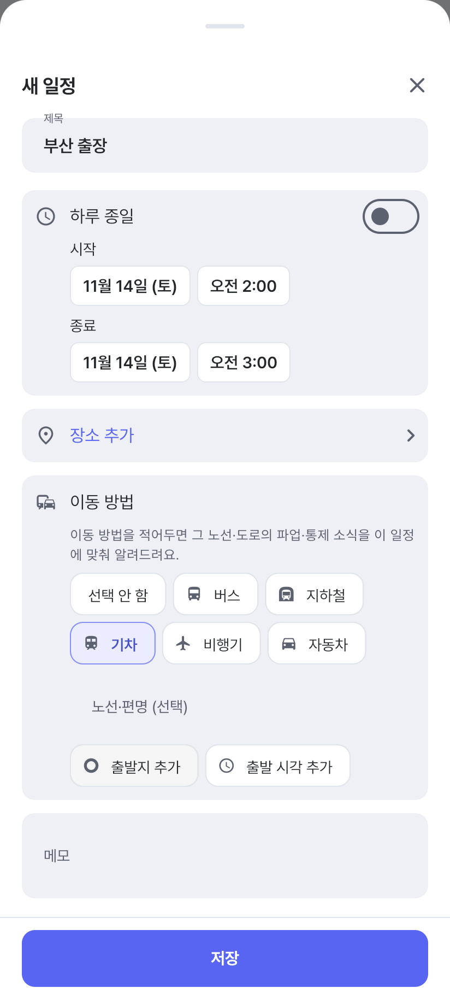
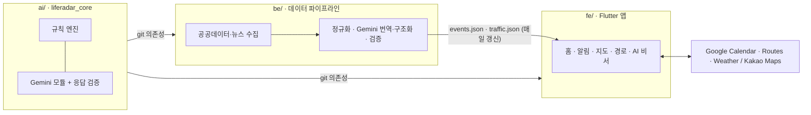

<div align="center">



# LifeRadar

**내 일정을 챙기는 AI 동료**

일정·관심사·이동 경로에 행사와 교통 정보를 연결해, 묻기 전에 *"이건 당신에게 중요해요, 이유는 이거예요"* 라고 알려주는 앱

[](https://youtu.be/Sjh8cfFDoKc)
[](https://drive.google.com/file/d/1n6Zk4ZCfaOjXBC2wYlcID8ptnPDMxG6i/view?usp=sharing)


2026 AI 우왕톤 · Team 27 **DaLab** · 주제 *"AI는 동료가 될 수 있을까?"*

</div>

<p align="center">
  
  
  
  
  
</p>

## ▶️ 바로 보기 · 설치

<table>
<tr>
<td width="55%" align="center">
<a href="https://youtu.be/Sjh8cfFDoKc"></a>
<br><b>🎬 <a href="https://youtu.be/Sjh8cfFDoKc">시연 영상 보기 (YouTube)</a></b>
</td>
<td width="45%" align="center">
<a href="https://drive.google.com/file/d/1n6Zk4ZCfaOjXBC2wYlcID8ptnPDMxG6i/view?usp=sharing"></a>
<br><b>📱 <a href="https://drive.google.com/file/d/1n6Zk4ZCfaOjXBC2wYlcID8ptnPDMxG6i/view?usp=sharing">Android APK 다운로드</a></b>
<br><sub>휴대폰 카메라로 QR을 찍으면 바로 받을 수 있어요</sub>
</td>
</tr>
</table>

**Android에 설치하기** (Android 6.0 이상, 버전 1.0.11)
1. 위 링크나 QR로 Google Drive에서 APK를 다운로드합니다.
2. 파일을 열고, *"출처를 알 수 없는 앱"* 안내가 나오면 **설정 → 이 출처 허용**을 켭니다.
3. **설치** → 앱을 열고 **Google로 계속하기** 또는 **게스트로 둘러보기**를 선택합니다.

> Google 로그인 중 *"Google에서 확인하지 않은 앱"* 화면이 나오면 **고급 → LifeRadar(으)로 이동**을 누르세요 (심사 중인 테스트 앱이라 표시됩니다). 로그인 없이 게스트로도 주요 기능을 볼 수 있습니다.

## 문제

행사·공모전, 파업·도로 통제 정보는 여러 서비스에 흩어져 있습니다. 사용자는 직접 검색하고 **내 일정·이동 경로와 하나하나 비교**해야 하고, 그래서 관심 있는 기회를 늦게 알거나 이동 당일에야 차질을 알게 됩니다.

## 해결 — 알려주는 것은 AI, 결정은 사람

| | 기능 | 설명 |
|---|---|---|
| 🔔 | **일정 알림** | 일정 날짜·장소 근처의 대형 행사, 파업 보도, 공식 교통 통제를 일정과 연결해 **이유·출처**와 함께 표시 |
| 🗺️ | **경로 위 추천** | 출발→도착 경로와 이동 수단에 맞춰, 경로 근처 관심 행사와 추가 거리·시간 안내 |
| 🚆 | **대중교통 경로 등록** | 두 일정 사이 실제 대중교통 경로(노선·승하차역·시간표)를 골라 저장, 그 노선의 파업·통제가 이 일정의 경고가 됨 |
| ✨ | **AI 비서** | 내 일정과 실제 행사 데이터 안에서만 답하고, 캘린더 추가는 사용자가 **[추가]** 를 눌러야 실행 |
| 🙋 | **AI 관심사 설정** | 자기소개 한두 문장에서 관심사를 **원문 인용과 함께 제안**, 사용자가 확인 후 적용 |
| 📅 | **캘린더·피드백** | Google 캘린더 연동, 신청 마감 알림, 👍/👎 로 추천 순위 조정 |

## AI가 사실을 만들지 않게

```
공공 API 사실 ──▶ 규칙 엔진 (코드) ──▶ Gemini (설명만) ──▶ 검증 (코드) ──▶ 카드
날짜·장소·링크     무엇을 보여줄지 결정    이유를 자연어로       후보 밖 행사·근거 없는 숫자면
                   (결정론적, 테스트됨)                          규칙 문장으로 대체
```

- **판단은 코드**: 관심사·취향·거리·시간으로 점수를 매기는 규칙 엔진 (`InsightEngine`, `RouteMatcher`, `TrafficMatcher`, `Taste`)
- **언어는 Gemini**: 추천 이유 설명, 뉴스 파업 기사 구조화, 자기소개 → 관심사 제안, AI 비서 답변
- **검증은 다시 코드**: 인용문이 기사 원문에 실제로 있는지, 숫자가 입력 사실에 있는지 확인한 뒤에만 표시

## 구조



| 폴더 | 내용 | 원본 저장소 |
|---|---|---|
| [`fe/`](fe/) | Flutter 앱 (Android·웹), Riverpod · go_router | [WOOWANGTHON_TEAM_27_FE](https://github.com/woowangthon/WOOWANGTHON_TEAM_27_FE) |
| [`be/`](be/) | GitHub Actions로 매일 수집·게시하는 데이터 파이프라인 | [WOOWANGTHON_TEAM_27_BE](https://github.com/woowangthon/WOOWANGTHON_TEAM_27_BE) |
| [`ai/`](ai/) | 판단 엔진과 AI 모듈 (`liferadar_core`, 순수 Dart) | [WOOWANGTHON_TEAM_27_AI](https://github.com/woowangthon/WOOWANGTHON_TEAM_27_AI) |

세 폴더는 원본 저장소의 커밋 기록을 그대로 가져온 것입니다 (`git subtree`, 11/15 제출 시점). 자세한 설계·실행 방법은 각 폴더의 README를 참고하세요.

## 데이터

- **행사 658건** — 서울 열린데이터광장 문화행사 · KOPIS 공연 · 한국관광공사 TourAPI 축제
- **교통** — 서울 TOPIS(시내 도로), ITS(고속도로·국도), 뉴스 파업 보도(Gemini 구조화, 참고용)
- **공모전** — 공개 포털 주간 수집

## 실행

```bash
cd fe
flutter pub get
flutter run -d chrome --web-port=8080 --dart-define-from-file=env.json   # 웹
flutter build apk --release --split-per-abi --dart-define-from-file=env.json   # Android
```

`env.json`(API 키)은 저장소에 포함하지 않습니다. 필요한 키 목록은 [fe/README.md](fe/README.md#8-실행)를 참고하세요.

## 품질

단위 테스트 **325개** (FE 145 · AI 105 · BE 75, 11/15 기준), 세 저장소 모두 GitHub Actions CI.

## 팀 — DaLab

| 이름 | 역할 | 기여 |
|---|---|---|
| **Aliboev Abbos** | 프론트엔드 · 백엔드 · AI | Flutter 앱 화면, 규칙 기반 추천·교통 판정 엔진, Gemini 연동(AI 비서·파업 기사 구조화), 데이터 수집 파이프라인 |
| **전영우** | 기획 · 디자인 · 개발 | 서비스 기획, 발표 자료·화면 디자인, 공공데이터·외부 API 조사, 교통 v2·공모전 수집, 대중교통 경로 등록 |

개발 기간: 2026-10-24 ~ 2026-11-15 · 개발 과정에서 AI 코딩 도우미(Claude)를 사용했고 커밋에 공동 작성자로 표시했습니다.


## 라이선스

[MIT](LICENSE) © 2026 Abbos Aliboev, 전영우 (Team 27 DaLab)
