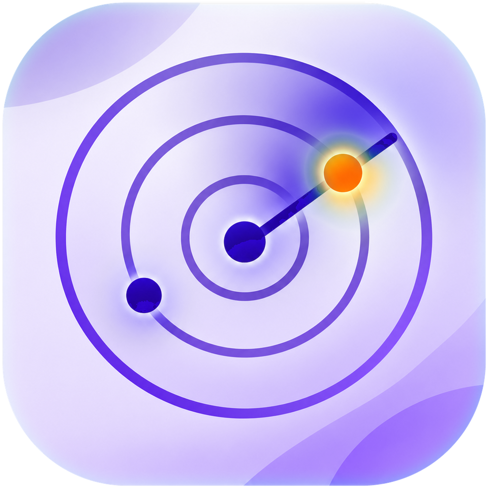
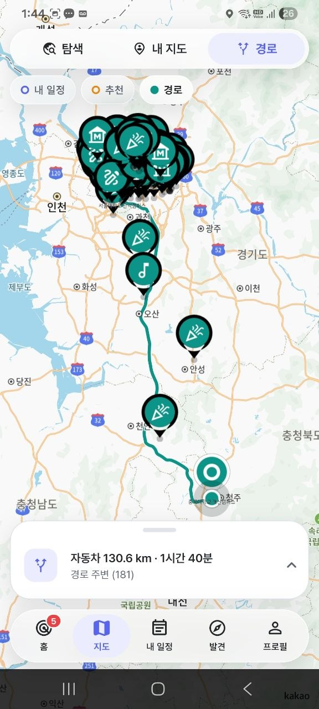
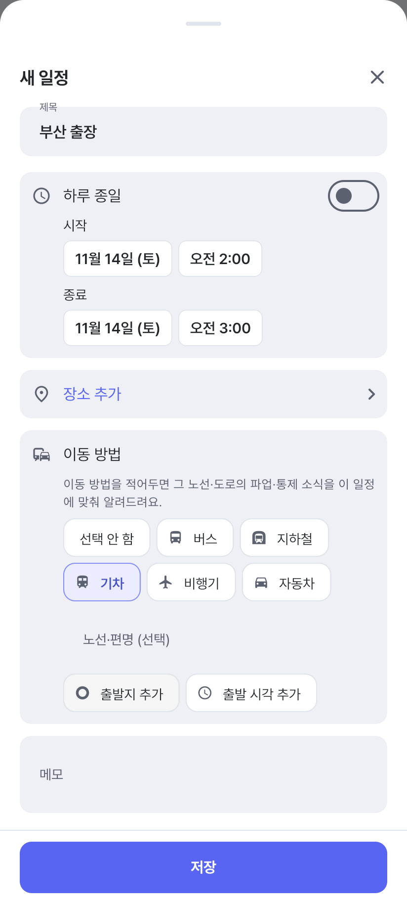
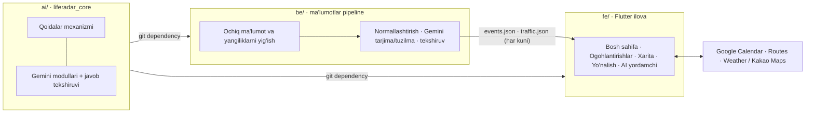

<div align="center">



[🇰🇷 한국어](README.md) · [🇬🇧 English](README.en.md) · **🇺🇿 O‘zbekcha**

# LifeRadar

**Rejalaringizni kuzatib boradigan AI hamkasb**

LifeRadar kalendaringiz, qiziqishlaringiz va yo‘nalishlaringizni haqiqiy tadbirlar va transport ma’lumotlari bilan bog‘laydi. Siz so‘ramasdan oldin *“bu siz uchun muhim, sababi mana bu”* deb aytib beradi.

[](https://youtu.be/Sjh8cfFDoKc)
[](https://drive.google.com/file/d/1n6Zk4ZCfaOjXBC2wYlcID8ptnPDMxG6i/view?usp=sharing)


2026 AI Woowangthon (Koreya) · 27-jamoa **DaLab** · Mavzu: *“AI hamkasb bo‘la oladimi?”*

</div>

<p align="center">
  
  
  
  
  
</p>

## ▶️ Ko‘rish · O‘rnatish

<table>
<tr>
<td width="55%" align="center">
<a href="https://youtu.be/Sjh8cfFDoKc"></a>
<br><b>🎬 <a href="https://youtu.be/Sjh8cfFDoKc">Demo videoni ko‘rish (YouTube)</a></b>
</td>
<td width="45%" align="center">
<a href="https://drive.google.com/file/d/1n6Zk4ZCfaOjXBC2wYlcID8ptnPDMxG6i/view?usp=sharing"></a>
<br><b>📱 <a href="https://drive.google.com/file/d/1n6Zk4ZCfaOjXBC2wYlcID8ptnPDMxG6i/view?usp=sharing">Android APK’ni yuklab olish</a></b>
<br><sub>QR-kodni telefon kamerasi bilan skanerlang</sub>
</td>
</tr>
</table>

**Android’ga o‘rnatish** (Android 6.0 va undan yuqori, versiya 1.0.11)
1. Yuqoridagi havola yoki QR-kod orqali APK’ni Google Drive’dan yuklab oling.
2. Faylni oching. *“Noma’lum ilovalarni o‘rnatish”* haqida xabar chiqsa, **Sozlamalar → Ushbu manbaga ruxsat berish** ni yoqing.
3. **O‘rnatish** ni bosing, ilovani oching va **Google bilan davom etish** yoki **Mehmon sifatida ko‘rish** ni tanlang.

> Google bilan kirishda *“Google bu ilovani tekshirmagan”* degan oyna chiqsa, **Qo‘shimcha (Advanced) → LifeRadar’ga o‘tish** ni bosing (ilova Google tekshiruvidan o‘tmagan test ilovasi bo‘lgani uchun shunday chiqadi). Kira olmasangiz, asosiy funksiyalarni mehmon sifatida ham ko‘rishingiz mumkin. Ilova interfeysi koreys va ingliz tillarida.

## Muammo

Tadbirlar va tanlovlar, ish tashlashlar va yo‘l yopilishlari haqidagi ma’lumotlar turli xizmatlarga sochilib ketgan. Ularni o‘zingiz qidirib, **o‘z rejangiz va yo‘nalishingiz bilan birma-bir solishtirishingiz** kerak. Natijada qiziq imkoniyatlardan kech xabar topasiz yoki yo‘lga chiqadigan kuni kutilmagan to‘siqqa duch kelasiz.

## Yechim — AI xabar beradi, qarorni siz qilasiz

| | Funksiya | Nima qiladi |
|---|---|---|
| 🔔 | **Reja ogohlantirishlari** | Rejangiz sanasi va joyi yaqinidagi katta tadbirlar, ish tashlash xabarlari va rasmiy yo‘l yopilishlarini shu rejaga bog‘laydi. Har doim **sababi va manbasi** bilan |
| 🗺️ | **Yo‘l ustidagi tadbirlar** | Qayerdan → qayerga yo‘nalishingiz va transport turingizga qarab, yo‘l yaqinidagi qiziqarli tadbirlarni qo‘shimcha masofa va vaqti bilan ko‘rsatadi |
| 🚆 | **Jamoat transporti yo‘nalishi** | Ikki reja orasidagi haqiqiy yo‘nalishni (liniyalar, bekatlar, jadval) tanlab saqlaysiz. O‘sha liniyadagi ish tashlash yoki yopilish shu reja uchun ogohlantirishga aylanadi |
| ✨ | **AI yordamchi** | Faqat sizning rejalaringiz va haqiqiy tadbirlar ma’lumoti asosida javob beradi. Kalendarga qo‘shish faqat siz **[Qo‘shish]** ni bosganingizda bajariladi |
| 🙋 | **AI bilan qiziqishlarni sozlash** | O‘zingiz haqingizda yozgan bir-ikki gapdan qiziqishlaringizni **o‘z so‘zlaringizdan iqtibos keltirib** taklif qiladi. Saqlashdan oldin siz tasdiqlaysiz |
| 📅 | **Kalendar va fikr-mulohaza** | Google Calendar bilan bog‘lanish, ariza muddati eslatmalari, 👍/👎 orqali tavsiyalar tartibini o‘zgartirish |

## AI ma’lumot to‘qib chiqarmasligi uchun

```
Ochiq API faktlari ──▶ Qoidalar mexanizmi (kod) ──▶ Gemini (faqat matn) ──▶ Tekshiruv (kod) ──▶ Karta
sana·joy·havola         nimani ko‘rsatishni hal qiladi   sababini so‘z bilan     ro‘yxatda yo‘q tadbir yoki asossiz
                        (deterministik, testlangan)      tushuntiradi            raqam → qoidaga asoslangan matn
```

- **Qarorni kod qabul qiladi**: qiziqish, did, masofa va vaqt bo‘yicha ball beradigan qoidalar mexanizmi (`InsightEngine`, `RouteMatcher`, `TrafficMatcher`, `Taste`)
- **Matnni Gemini yozadi**: tavsiya sababi, ish tashlash haqidagi maqolalarni tuzilmaga solish, qiziqish takliflari, yordamchi javoblari
- **Kod yana tekshiradi**: iqtibos faqat maqolaning asl matnida haqiqatan bo‘lsa, raqam esa faqat kirish faktlarida mavjud bo‘lsa ko‘rsatiladi

## Arxitektura



| Papka | Tarkibi | Asl repozitoriy |
|---|---|---|
| [`fe/`](fe/) | Flutter ilova (Android va web), Riverpod · go_router | [WOOWANGTHON_TEAM_27_FE](https://github.com/woowangthon/WOOWANGTHON_TEAM_27_FE) |
| [`be/`](be/) | GitHub Actions orqali har kuni ma’lumot yig‘ib e’lon qiladigan pipeline | [WOOWANGTHON_TEAM_27_BE](https://github.com/woowangthon/WOOWANGTHON_TEAM_27_BE) |
| [`ai/`](ai/) | Qaror mexanizmi va AI modullari (`liferadar_core`, sof Dart) | [WOOWANGTHON_TEAM_27_AI](https://github.com/woowangthon/WOOWANGTHON_TEAM_27_AI) |

Uchala papka asl repozitoriylarning to‘liq commit tarixini saqlaydi (`git subtree`, 15-noyabrda topshirilgan holat). Batafsil tuzilish va sozlash har bir papkaning README faylida (koreys tilida).

## Ma’lumotlar

- **658 ta tadbir**: Seul ochiq ma’lumotlari (madaniy tadbirlar) · KOPIS (spektakl va konsertlar) · Koreya Turizm tashkiloti TourAPI (festivallar)
- **Transport**: Seul TOPIS (shahar yo‘llari), ITS (avtomagistral va milliy yo‘llar), ish tashlash haqidagi yangiliklar (Gemini tuzilmaga soladi, ma’lumot uchun)
- **Tanlovlar**: ochiq portallardan haftalik yig‘iladi

## O‘zingiz ishga tushirish

```bash
cd fe
flutter pub get
flutter run -d chrome --web-port=8080 --dart-define-from-file=env.json   # web
flutter build apk --release --split-per-abi --dart-define-from-file=env.json   # Android
```

`env.json` (API kalitlari) repozitoriyga kiritilmagan. Kerakli kalitlar ro‘yxati [fe/README.md](fe/README.md#8-실행) da.

## Sifat

**325 ta unit test** (FE 145 · AI 105 · BE 75, 15-noyabr holatiga), uchala repozitoriyda ham GitHub Actions CI.

## Jamoa — DaLab

| Ism | Rol | Hissa |
|---|---|---|
| **Aliboev Abbos** | Frontend · Backend · AI | Flutter ilova ekranlari, qoidalarga asoslangan tavsiya va transport mexanizmlari, Gemini integratsiyasi (yordamchi, ish tashlash yangiliklarini tuzilmaga solish), ma’lumot yig‘ish pipeline’i |
| **Jeon Yeongwoo (전영우)** | Rejalashtirish · Dizayn · Dasturlash | Xizmat rejasi, taqdimot va interfeys dizayni, ochiq ma’lumot va tashqi API’larni o‘rganish, transport v2 va tanlovlarni yig‘ish, jamoat transporti yo‘nalishini saqlash |

Ishlab chiqish davri: 2026-10-24 – 2026-11-15 · Ishlab chiqishda AI dasturlash yordamchisi (Claude) ishlatildi va commit’larda hammuallif sifatida ko‘rsatildi.

## Litsenziya

[MIT](LICENSE) © 2026 Abbos Aliboev, 전영우 (Team 27 DaLab)
